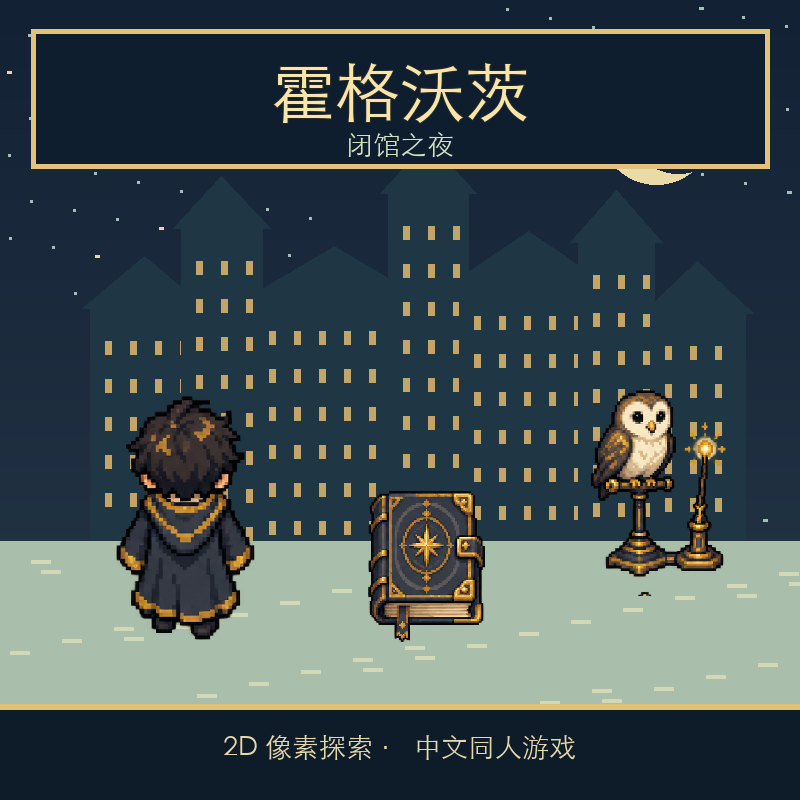

# 霍格沃茨：闭馆之夜



一款可在浏览器游玩的中文 2D 俯视角同人小游戏。闭馆钟声响起前，你要从雪夜庭院进入城堡，调查图书馆里被调包的《第十三页》，用显影咒找回真书，避开巡逻并从庭院大门离开。

游戏包含四个相连场景、八分钟倒计时、两种成功结局，以及因被发现或超时触发的失败结局。无需构建步骤或游戏后端。

## 本地运行

在仓库根目录运行：

```bash
python3 -m http.server 8000 --directory dist
```

然后在浏览器打开 <http://localhost:8000/>。`dist/` 内含完整的网页游戏。页面会尝试初始化星匣 GameSDK；普通浏览器中也可以直接试玩，游戏流程不依赖平台存储、AI、兑换或对象存储能力。

## 操作

| 操作 | 键盘 | 触屏 |
| --- | --- | --- |
| 移动 | 方向键或 WASD | 屏幕方向键；也可点地图自动寻路 |
| 互动、推进对话 | J、Z、空格或 Enter | A 按钮 |
| 施放显影咒 | F | ✦ 按钮 |
| 暂停或继续 | P 或 Esc | 暂停按钮 |

靠近人物或可调查的物件后互动。任务提示会随调查进度更新；巡逻者累计发现你三次，或倒计时归零，都会结束本次冒险。

<details>
<summary>通关路线（包含谜题提示）</summary>

1. 从庭院进入城堡走廊，再前往图书馆。
2. 调查 H-13 书架与借阅台记录，向图书管理员取得禁书区许可。
3. 在禁书区按 F 显影，找到并取回隐藏的真书。
4. 避开巡逻，返回庭院南侧大门，选择归还或带走魔法书。

</details>

## 项目文件

```text
.
├── README.md
├── cover.png                       # 游戏封面
├── star-letter.json                # 星匣项目清单
├── dist/                           # 可直接部署的完整游戏
│   ├── index.html
│   ├── style.css
│   ├── game.js
│   └── assets/                     # 游戏中使用的裁切图像
└── source-assets/
    ├── magic-school-sprite-atlas.png
    └── PROMPTS.md                  # 生图素材说明
```

人物、猫头鹰、书柜、拱门和魔法书素材由 AI 生图生成，并从原创图集中裁切使用；封面由这些图像重新排版。地面、建筑与界面由 Canvas/CSS 绘制。素材生成方向见 [PROMPTS.md](./source-assets/PROMPTS.md)。

## 与参考游戏的关系

本作参考了 Vampigeon Games 的 [Hogwarts Legacy Demake](https://vampigeon.itch.io/hogwarts-legacy-demake)。对其网页运行构件的逆向观察表明，参考游戏通过网页模拟器加载 Game Boy ROM；其作者页介绍了俯视探索、按键互动、任务与多结局。

《闭馆之夜》借鉴这些可确认的游玩结构，重新设计了中文剧情、图书馆调查路线、场景、程序与图像。它是面向“图书馆闭馆倒计时”主题的原创同人重构，**不是原 ROM 的汉化或逐关复刻**。本仓库不包含参考游戏的 ROM、代码或画面；参考游戏的完整任务与全部结局也未作为本作的复刻依据。

## 验证与星匣状态

- 开发时已在浏览器走通“归还之书”结局，并验证累计三次被巡逻者发现的失败结局。
- `node --check dist/game.js` 通过；`star-letter check .` 曾返回 `ok: true`、无警告。
- `star-letter.json` 中的星匣游戏 ID 为 `8757`。本项目曾以 `star-letter publish --draft` 保存为草稿；正式发布及活动投稿状态请以星匣平台当前记录为准。
